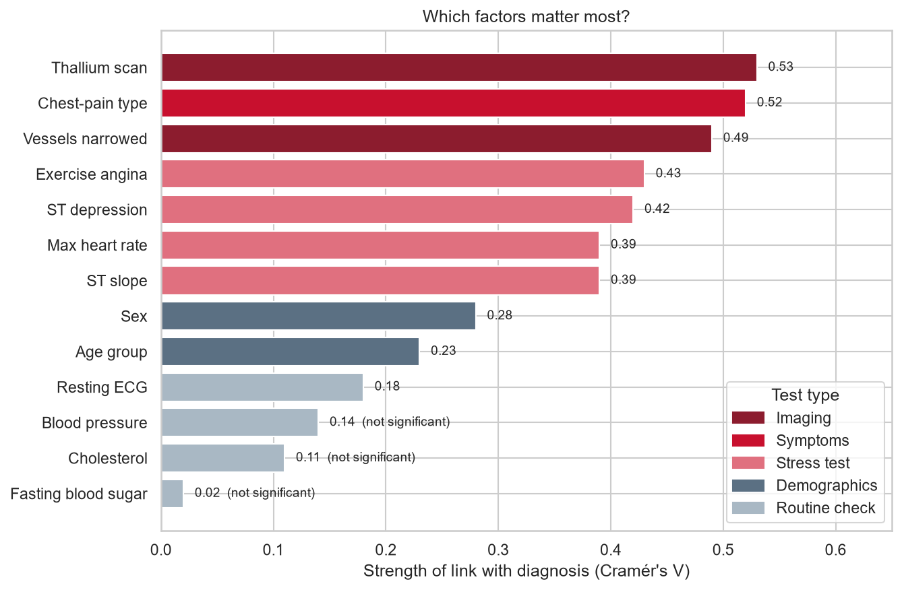
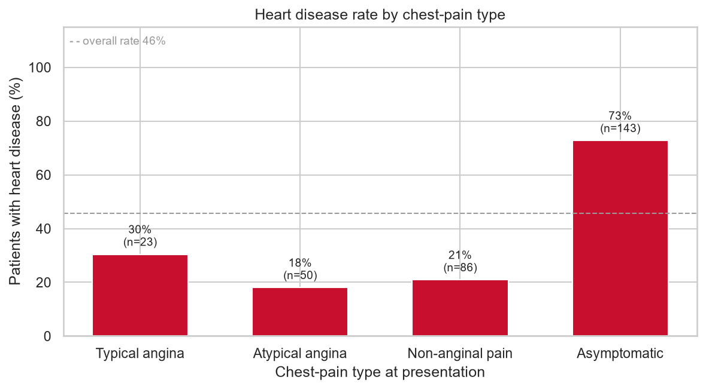
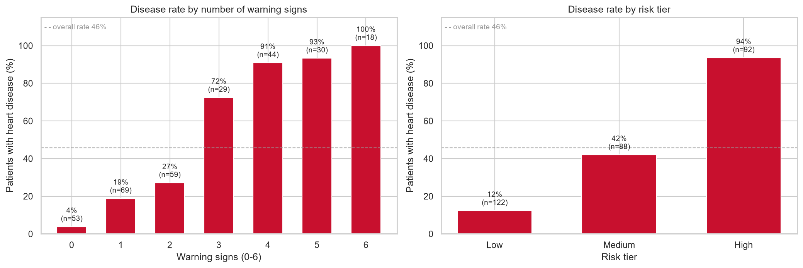
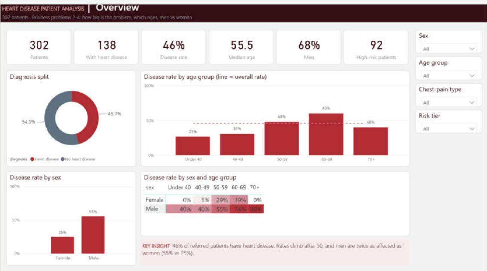
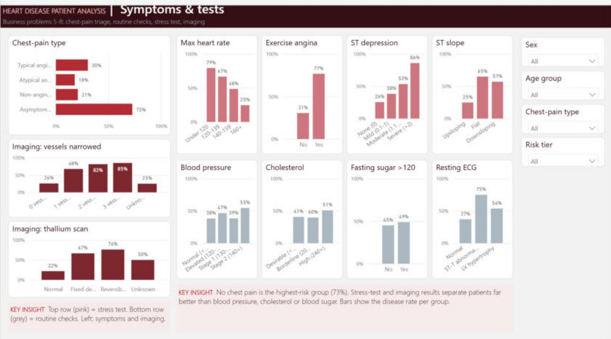
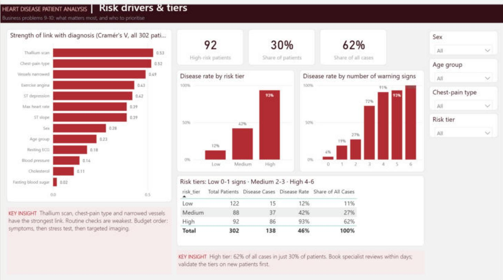
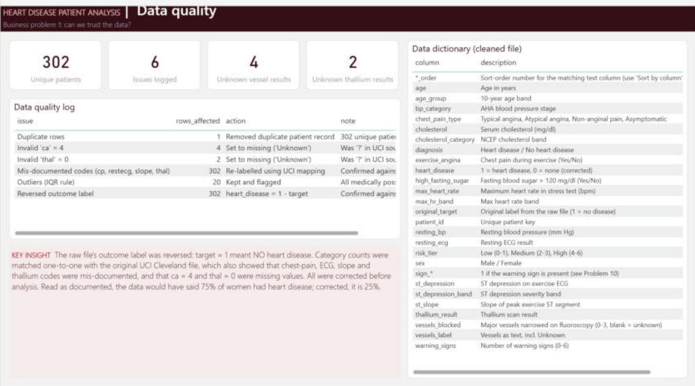

# Heart Disease Patient Analysis
### End-to-end data analyst portfolio project · Python → Power BI → PowerPoint

A hospital cardiology department has records for **302 patients** who were checked for heart disease. It wants to use them to improve **screening, triage and the use of diagnostic tests**.

This project:
* Validates and cleans the data.
* Answers **10 business problems** with Python.
* Publishes the results in an interactive **Power BI dashboard** and a **stakeholder presentation**.



---

## Key findings at a glance

| | |
|---|---|
| **46%** | of referred patients have heart disease (138 of 302) |
| **55% vs 25%** | disease rate in men compared with women |
| **60%** | disease rate at age 60–69, against 27% under 40 |
| **73%** | disease rate in patients with **no** chest pain, the highest-risk group |
| **Weak** | blood pressure, cholesterol and blood sugar barely separate patients |
| **62%** | of all cases fall in a High-risk tier that is only 30% of patients |
| **⚠ Reversed label** | the raw file's outcome column meant the opposite of its documentation. It was caught and fixed during validation |

---

## Table of contents
1. [Business problems](#1-business-problems)
2. [Dataset](#2-dataset)
3. [Tools](#3-tools)
4. [Repository structure](#4-repository-structure)
5. [Project process, step by step](#5-project-process-step-by-step)
6. [Findings and recommendations](#6-findings-and-recommendations)
7. [Power BI dashboard](#7-power-bi-dashboard)
8. [Presentation](#8-presentation)
9. [How to reproduce](#9-how-to-reproduce)
10. [Limitations](#10-limitations)
11. [Appendix: machine learning](#11-appendix-machine-learning)

---

## 1. Business problems

| # | Business problem | Why the business cares |
|---|---|---|
| 1 | **Can we trust the data?** Is it complete, valid and correctly labelled? | Decisions built on wrong labels are wrong decisions |
| 2 | **How big is the problem?** What share of patients have heart disease, and who are they? | Capacity planning and a baseline for every comparison |
| 3 | **Which age groups are most affected?** | When to start screening |
| 4 | **Do men and women differ?** | Gender-targeted outreach and screening |
| 5 | **Can chest-pain type triage patients?** | Faster, cheaper first-contact decisions |
| 6 | **Do routine checks (BP, cholesterol, blood sugar, ECG) separate patients?** | Whether cheap tests can act as a filter |
| 7 | **How useful is the exercise stress test?** | Value of a mid-cost test |
| 8 | **How useful are imaging tests (fluoroscopy, thallium)?** | Where to spend the most expensive budget |
| 9 | **Which factors matter most overall?** | Prioritising the diagnostic budget |
| 10 | **Can we segment patients into risk tiers?** | Prioritising follow-up appointments |

## 2. Dataset

The data is the **UCI Cleveland Heart Disease** dataset, Kaggle version: [`data/raw/heart-disease.csv`](data/raw/heart-disease.csv).
* **Size:** 303 rows (302 unique patients) × 14 columns.
* **Source:** [UCI Machine Learning Repository](https://archive.ics.uci.edu/dataset/45/heart+disease).

| Group | Columns |
|---|---|
| Demographics | age, sex |
| Symptoms | chest-pain type |
| Routine checks | resting blood pressure, cholesterol, fasting blood sugar, resting ECG |
| Exercise stress test | max heart rate, exercise angina, ST depression, ST slope |
| Imaging | major vessels narrowed (fluoroscopy), thallium scan |
| Outcome | heart disease yes / no |

The full cleaned data dictionary is in [`data/processed/data_dictionary.csv`](data/processed/data_dictionary.csv).

## 3. Tools

| Stage | Tools |
|---|---|
| Cleaning and analysis | Python 3, pandas, NumPy, SciPy (chi-square, Mann–Whitney U, Cramér's V), Jupyter |
| Visualisation | Matplotlib, Seaborn, **Power BI Desktop** (DAX, Power Query) |
| Communication | PowerPoint |
| Version control | Git and GitHub |

## 4. Repository structure

```
├── data/
│   ├── raw/heart-disease.csv              ← original file (never edited)
│   └── processed/
│       ├── heart_disease_clean.csv        ← cleaned, labelled, banded: Power BI fact table
│       ├── factor_ranking.csv             ← Problem 9 results
│       ├── data_quality_log.csv           ← Problem 1 issue log
│       ├── data_dictionary.csv            ← meaning of every clean column
│       └── summary_metrics.json           ← key numbers used in the slides
├── notebooks/
│   ├── 01_Heart_Disease_Data_Analysis_final.ipynb ← FINAL: same analysis in simple, beginner-friendly code
│   ├── 01_Heart_Disease_Data_Analysis.ipynb    ← full version: also exports charts and slide metrics
│   └── 02_Heart_Disease_ML_Classification.ipynb ← optional appendix: predictive model
├── powerbi/
│   ├── Heart_Disease_Dashboard_final.pbix ← FINAL DASHBOARD: open in Power BI Desktop
│   ├── Heart_Disease_Dashboard_final.pbip ← same dashboard as a text-based Power BI Project (Git-friendly)
│   ├── Heart_Disease_Dashboard_final.SemanticModel/ ← data model: tables, DAX measures, sort orders (TMDL)
│   ├── Heart_Disease_Dashboard_final.Report/  ← report layout: 4 pages, visuals
│   ├── Dashboard_Build_Guide.md           ← how the dashboard is designed, page by page
│   ├── DAX_Measures.md                    ← every DAX measure, explained
│   └── Heart_Disease_Theme.json           ← optional Power BI colour theme
├── presentation/
│   └── Heart_Disease_Data_Analysis_final.pptx ← FINAL 23-slide stakeholder deck
├── videos/
│   ├── 01_Notebook_Process_Walkthrough_final.mp4   ← narrated walkthrough of the notebook (7.7 min)
│   └── 02_PowerBI_Dashboard_Walkthrough_final.mp4  ← narrated walkthrough of the dashboard (4.6 min)
├── images/                                ← charts exported by the notebook
├── archive/                               ← original notebook and earlier deck (for reference)
├── requirements.txt
└── README.md
```

## 5. Project process, step by step

### Step 1: Define the business problems
The project starts from **business questions**, not from the data. Each of the 10 problems above names a decision the department needs to make, such as who to screen, how to triage and which test to buy.

### Step 2: Validate the data (Business Problem 1)
Notebook section 3 runs four checks:
1. **Completeness:** no missing values.
2. **Uniqueness:** 1 duplicate patient.
3. **Validity:** 6 out-of-range codes (`ca = 4`, `thal = 0`).
4. **Meaning:** we counted every category and compared it with the original UCI file. The counts line up one-to-one, and they showed that:
   * **`target = 1` means *no* heart disease**, the reverse of the notebook's original data dictionary.
   * `cp`, `restecg`, `slope` and `thal` are numbered differently from their documentation.
   * The out-of-range codes were missing values (`?`) in the source.

> Read as documented, the data would have said 75% of women and 45% of men had heart disease, which is clinically implausible. After correction the figures are 25% for women and 55% for men.

### Step 3: Clean the data

| Action | Result |
|---|---|
| Drop the duplicate row | 302 unique patients |
| Invalid codes set to missing | Labelled *Unknown*; patients kept |
| `heart_disease = 1 − target` | Correct outcome (1 = disease) |
| Decode every category | e.g. `cp = 0` becomes "Asymptomatic" |
| Rename columns to plain English | e.g. `trestbps` becomes `resting_bp` |
| Outliers (20 values by the IQR rule) | Kept and flagged, because all are medically possible |

### Step 4: Feature engineering
* **Clinical bands:**
  * Age: 10-year groups.
  * Blood pressure: AHA stages.
  * Cholesterol: NCEP bands.
  * Max heart rate and ST depression: severity bands.
* **Six warning-sign flags** and a **risk tier** (Low / Medium / High).
* **Sort-order columns**, so Power BI shows the bands in their logical order.

### Step 5: Analyse (Business Problems 2–10)
* For each factor, calculate the **disease rate by group** against the overall 46%.
* Test whether the differences are real:
  * **Chi-square** for categories.
  * **Mann–Whitney U** for numeric measurements.
* Rank all 13 factors on one scale with **Cramér's V** and the **rate gap** in percentage points.

### Step 6: Export for Power BI
The notebook writes 4 tidy CSV files to `data/processed/`.

### Step 7: Build the dashboard
Follow [`powerbi/Dashboard_Build_Guide.md`](powerbi/Dashboard_Build_Guide.md). See section 7 below.

### Step 8: Communicate
The PowerPoint deck has one slide per business problem. Each slide shows the **question, the evidence, the answer and the action**.

## 6. Findings and recommendations

| # | Finding | Recommendation |
|---|---|---|
| 1 | Outcome label reversed, 1 duplicate, 6 invalid codes | Validated data dictionary and automated checks before reporting |
| 2 | **46%** of 302 patients have heart disease; the typical patient is a man in his mid-50s | Plan for ~1 confirmed case per 2 referrals |
| 3 | Rate climbs from 27% (<40) to **60% (60–69)**; patients with disease are 6 years older (58 vs 52) | Routine screening from age 50 |
| 4 | **Men 55% vs women 25%**, at every age | Screen men from 40–45 and women from 50; review under-referral of women |
| 5 | **No chest pain = 73%**, the highest of all; typical angina is only 30% | Fast-track silent presentations in triage |
| 6 | BP, cholesterol and blood sugar add only 4–17 points, and the bands are not significant | Don't use routine checks as the referral gate |
| 7 | Severe ST depression 86%, max HR <120 79%, exercise angina 77% | Use the stress test early: the best-value mid-cost test |
| 8 | 3 narrowed vessels 85%; reversible thallium defect 76% | Reserve imaging for patients already flagged |
| 9 | Ranking: thallium 0.53 > chest pain 0.52 > vessels 0.49 > stress test 0.39–0.43 > sex and age > routine checks | Budget order: symptoms → stress test → targeted imaging |
| 10 | High tier: **93% disease**, 62% of all cases in 30% of patients; Low tier: 12% | Book follow-up by tier (High: specialist within days) |

<p align="center">
  
  
</p>

## 7. Power BI dashboard

**File:** [`powerbi/Heart_Disease_Dashboard_final.pbix`](powerbi/Heart_Disease_Dashboard_final.pbix). Open it in Power BI Desktop. The data is embedded, so it works straight away.



A 4-page interactive dashboard built on `heart_disease_clean.csv`:

| Page | Contents | Problems |
|---|---|---|
| **Overview** | KPI cards, diagnosis donut, rate by age and by sex, sex × age heatmap, synced slicers | 2–4 |
| **Symptoms & tests** | Chest-pain triage, 4 stress-test charts, imaging, routine checks | 5–8 |
| **Risk drivers & tiers** | Factor ranking, high-risk KPIs, rate by tier and by warning signs | 9–10 |
| **Data quality** | Issue log, unknown-value counts, data dictionary | 1 |

**Example DAX:**
```DAX
Disease Rate = DIVIDE ( [Disease Cases], [Total Patients] )
Overall Disease Rate = CALCULATE ( [Disease Rate], REMOVEFILTERS ( heart_disease_clean ) )
High Risk Share of Cases =
    DIVIDE ( CALCULATE ( [Disease Cases], heart_disease_clean[risk_tier] = "High" ), [Disease Cases] )
```

Further detail:
* All 22 measures, explained: [`powerbi/DAX_Measures.md`](powerbi/DAX_Measures.md).
* Design notes, page by page: [`powerbi/Dashboard_Build_Guide.md`](powerbi/Dashboard_Build_Guide.md).

**Refreshing the data.** The model reads the CSV files through a Power Query parameter called `DataFolder`. After cloning to a new location:
1. Go to **Home → Transform data → Edit parameters**.
2. Point `DataFolder` at your `data/processed/` folder.
3. Click **Refresh**.

**Power BI Project (.pbip).** The same dashboard is also saved as a text-based Power BI Project. The tables and DAX measures are in TMDL files and the report layout is in JSON, so every change shows up in Git diffs.

<p align="center">
  
  
</p>
<p align="center"></p>

## 8. Presentation

[`presentation/Heart_Disease_Data_Analysis_final.pptx`](presentation/Heart_Disease_Data_Analysis_final.pptx) has 23 slides:
* **Introduction:** objective, the 10 problems, process and dataset.
* **Findings:** one slide per business problem, each with question, chart, answer and action.
* **Dashboard and actions:** the dashboard, recommendations, limitations and next steps.

Every slide includes speaker notes.

## Video walkthroughs

Two narrated videos explain the process flow and every activity, with subtitles in matching `.srt` files.

| Video | What it covers |
|---|---|
| [`01_Notebook_Process_Walkthrough_final.mp4`](videos/01_Notebook_Process_Walkthrough_final.mp4) | Setup and load → data checks and the reversed label → cleaning → new columns → business problems 2–10 → export → summary |
| [`02_PowerBI_Dashboard_Walkthrough_final.mp4`](videos/02_PowerBI_Dashboard_Walkthrough_final.mp4) | Loading the CSVs → Power Query → data model → DAX measures → the 4 report pages → interactivity → saving and sharing |

## 9. How to reproduce

```bash
git clone https://github.com/<your-username>/<your-repo>.git
cd <your-repo>
pip install -r requirements.txt
jupyter notebook notebooks/01_Heart_Disease_Data_Analysis_final.ipynb
```
1. Run all cells. This rebuilds all 4 CSV files the dashboard reads: `heart_disease_clean`, `factor_ranking`, `data_quality_log` and `data_dictionary`. The full version, `01_Heart_Disease_Data_Analysis.ipynb`, produces the same data and also regenerates `images/` and the slide metrics.
2. Open `powerbi/Heart_Disease_Dashboard_final.pbix` in Power BI Desktop. If you moved the folder, update the `DataFolder` parameter first, then click Refresh.

## 10. Limitations

* **Small, old sample:** 302 patients from one hospital (Cleveland, 1988).
* **Referred patients only:** the rates are much higher than in the general population.
* **Association, not causation:** this is observational data.
* **Risk tiers are descriptive:** the warning signs were chosen from the same data, so they need validation on new patients.
* **Small subgroups:** for example, 70+ has only 10 patients and ST-T abnormality only 4.
* **Label and code corrections** were inferred by matching counts with the UCI source and should be confirmed with the data owner.

## 11. Appendix: machine learning

[`notebooks/02_Heart_Disease_ML_Classification.ipynb`](notebooks/02_Heart_Disease_ML_Classification.ipynb) is an optional extension. It compares Logistic Regression, KNN and Random Forest:
* **Best single test split:** about 88.5% accuracy (tuned Random Forest).
* **Logistic Regression, cross-validated:** about 83% accuracy.
* **Conclusion:** neither reliably reaches the 90% proof-of-concept goal.

The notebook was cleaned up from the original version in `archive/` and uses the corrected label.

---

**Data source:** Detrano, R. et al. *Heart Disease* dataset, UCI Machine Learning Repository.
