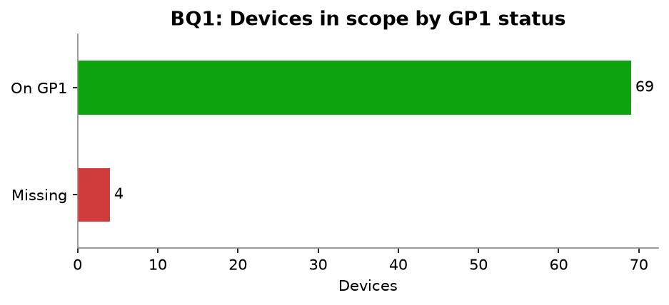
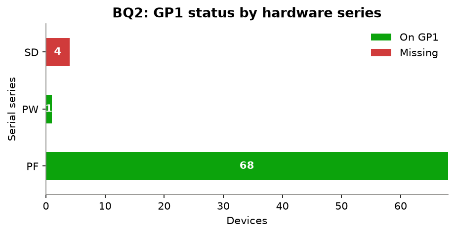
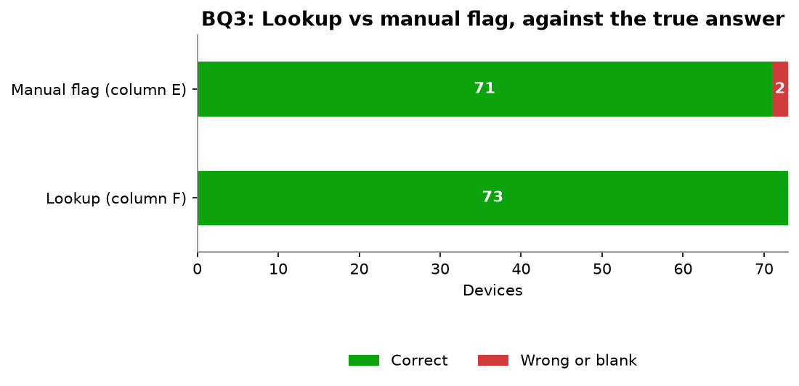
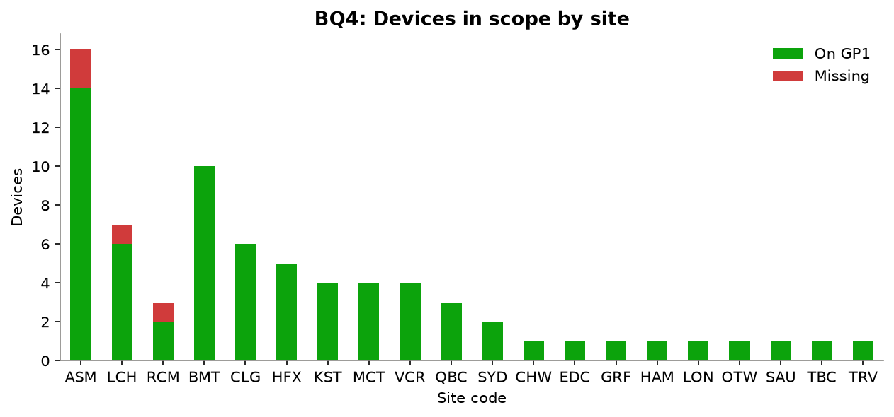

# Project 4 – Secure Boot Rollout: GP1 Coverage Check

A Python reconciliation of the laptops that need a Secure Boot policy against the GP1 device group that delivers it. It finds which devices are missing, why, and whether the team's own tracking can be trusted.

**73** devices in scope · **69** already in GP1 · **4** missing · **5** business questions

> **Privacy:** this is a public copy of real operational data. Serial numbers inside host names are replaced with consistent fake codes. The site code and the 2-letter series prefix are kept, and the same real serial always gets the same fake one, also in the Laptop Lifecycle project, so the cross-check still works. See [`docs/data_cleaning_notes.md`](docs/data_cleaning_notes.md).

## Repo structure
```
Project4_SecureBoot/
├── README.md
├── requirements.txt
├── .gitignore
├── data/
│   ├── raw/
│   │   ├── secure_boot_devices.csv
│   │   └── laptop_refresh_new_hosts.csv
├── notebooks/
│   └── Project4_SecureBoot_Analysis_final.ipynb
├── images/                       # 4 charts saved by the notebook
├── presentation/
│   └── Project4_SecureBoot_Presentation_final.pptx
└── docs/
    └── data_cleaning_notes.md
```

| Data file | What it is |
|---|---|
| `data/raw/secure_boot_devices.csv` | the team's working sheet: devices in scope, GP1 members, manual flag, lookup, side list (73 + 69 host names) |
| `data/raw/laptop_refresh_new_hosts.csv` | new laptop host names from the 2026 laptop refresh (from Project 5), used to explain the gaps |


## 1. What the data is
The source is a small working sheet built by an IT team to answer the question written in its own header, *"find which is not on gp1"*.

| Column | What it holds |
|---|---|
| A | **Devices in scope**: 73 laptop host names that should have the Secure Boot policy |
| C | **GP1 members**: 69 host names currently in the GP1 deployment group |
| E | A **manual flag** typed next to each device: `OK` or `NOT ON GP1` |
| F | A **lookup** result: `found` or `------------` |
| H | A hand-made list of devices believed to be missing |

A host name such as `ASM-LTPF3D8CA3` holds a **3-letter site code**, `LT` for laptop and the **serial number**. The first two letters of the serial give the **hardware series**: `PF` is the older fleet and `SD` the new 2026 laptops.

## 2. Business questions
1. **BQ1 Coverage:** How many in-scope devices are in GP1?
2. **BQ2 Gaps:** Which devices are missing, and what do they have in common?
3. **BQ3 Tracking quality:** Can the team trust its own manual flags?
4. **BQ4 Sites:** Where are the missing devices?
5. **BQ5 Root cause:** Are the gaps linked to the 2026 laptop refresh?

## 3. Validation and cleaning
* **The file is a working sheet, not a table:** there are two note rows on top, the lists sit side by side, and column H holds a hand-made list. Each list is read separately.
* **Devices in scope: 73, GP1 members: 69.** No duplicates within either list, and no stray spaces or lower-case names, so an exact host-name match is safe.
* **One host name breaks the naming pattern:** `SAU-LT-PF59121C` has an extra dash. It still matches between the two lists.
* **The side list in column H has 6 entries for 4 devices** (2 are repeated).
* **The manual flag (column E) is blank for 1 device**, and it says `NOT ON GP1` 5 times while the lookup (column F) finds only 4 missing.

The full list of steps is in [`docs/data_cleaning_notes.md`](docs/data_cleaning_notes.md).

## 4. Findings and recommendations
### BQ1 – Coverage


**Finding:** **69 of 73 in-scope devices (94.5%) are in GP1.** Every GP1 member is in scope, so the group holds nothing extra; the only gap is 4 devices that never joined.

**Recommendation:** Add the 4 missing devices to GP1 now, then re-run this check before declaring the rollout complete.

### BQ2 – Gaps


**Finding:** **All 4 missing devices are SD-series laptops**, and **none of the 4 SD-series devices in scope is in GP1**. All 68 PF-series and the 1 PW-series device are covered. The gap is not random: it is exactly the new hardware.

**Recommendation:** Treat this as a process gap, not 4 one-off misses. Find the step where new SD laptops should be added to GP1, and add it to the build checklist.

### BQ3 – Tracking quality


**Finding:** The lookup in column F is right for all 73 devices. **The manual flag in column E is wrong or blank for 2**: `TRV-LTPF3545AC` is marked `NOT ON GP1` but is in the group, and one device has no flag. The side list in column H names the right 4 devices but repeats 2 of them.

**Recommendation:** Drop the hand-typed flag and keep only the formula-driven lookup (or this notebook) as the source of truth, so the status can't drift from the data.

### BQ4 – Sites


**Finding:** The missing devices are at **L'Assomption (ASM, 2 of 16)**, **Lachine (LCH, 1 of 7)** and **Richmond (RCM, 1 of 3)**. Every other site is fully covered. ASM is the largest site in scope, so it carries half of the gap.

**Recommendation:** Ask the ASM, LCH and RCM site contacts to confirm the 4 laptops are in use, then add them to GP1 remotely.

### BQ5 – Root cause

**Finding:** **2 of the 4 missing devices appear in the 2026 laptop refresh list**: `ASM-LTSDBAB1AE` (L'Assomption) and `RCM-LTSDA1E289` (Richmond), both shipped on 14 Aug. The other 2 are SD-series laptops that the refresh list doesn't include. New laptops are reaching users without being added to the Secure Boot group.

**Recommendation:** Add "join GP1" to the refresh imaging checklist, next to the existing Teams, Asset Panda and group-membership steps. Then cross-check every SD-series host name against GP1 once a week until the refresh ends.

## 5. Summary
| # | Question | Answer |
|---|---|---|
| BQ1 | Coverage | **69 of 73 (94.5%)** devices in GP1 |
| BQ2 | Gaps | All **4 missing are SD-series**: 0 of 4 new laptops covered |
| BQ3 | Tracking quality | Lookup right for 73 of 73; manual flag wrong or blank for **2** |
| BQ4 | Sites | ASM (2), LCH (1), RCM (1) |
| BQ5 | Root cause | **2 of 4** are laptops from the 2026 refresh |

**Main message:** the Secure Boot rollout covers the old fleet completely but misses every new laptop. Fixing the imaging checklist closes the gap for good.

## 6. Presentation
[`presentation/Project4_SecureBoot_Presentation_final.pptx`](presentation/Project4_SecureBoot_Presentation_final.pptx) is a 14-slide deck with speaker notes. It covers what the data is, the 5 business questions, how the project was done, the validation results, the findings, the recommendations, and the limitations.

## 7. Limitations
- One snapshot of the lists; no dates
- 2 missing SD devices aren't in the refresh list, so their origin is unknown
- GP1 membership doesn't prove Secure Boot is on

**Next steps:**
- Re-run after the 4 devices are added
- Pull Secure Boot state from Intune to confirm it is enabled
- Automate the match as a weekly report

## 8. How to reproduce
1. Install Python 3 and the packages in `requirements.txt`:
   ```bash
   pip install -r requirements.txt
   ```
2. Open `notebooks/Project4_SecureBoot_Analysis_final.ipynb` in Jupyter and choose **Run All**. The notebook reads `data/raw/`, re-creates every chart in `images/`.
3. Paths in the notebook are relative (`../data/...`, `../images/...`), so run it from the `notebooks/` folder.
