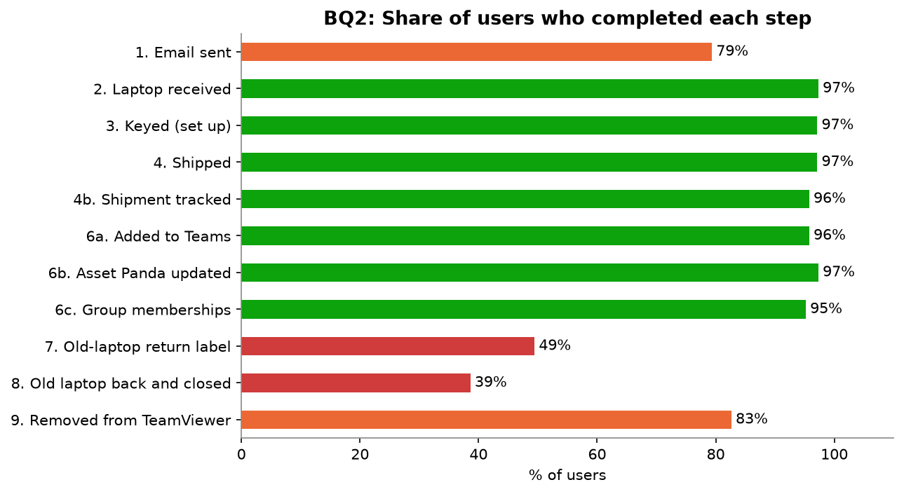
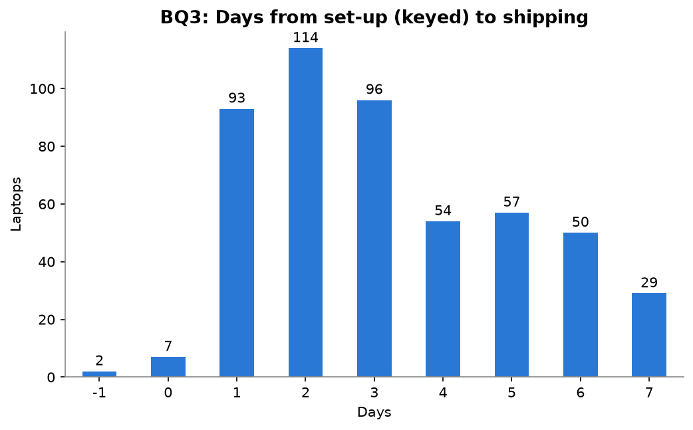
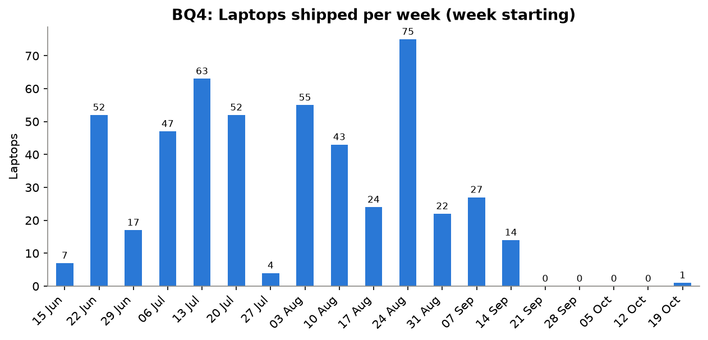
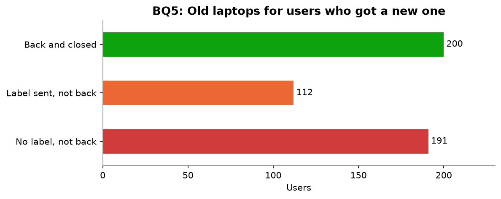
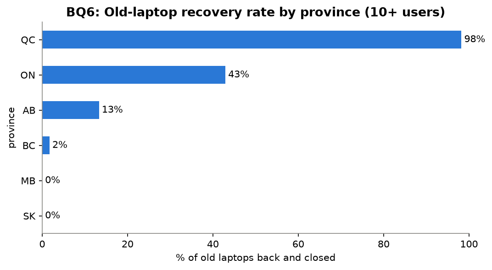

# Project 5 – Laptop Lifecycle: 2026 Refresh Programme Analysis

A Python analysis of the tracker for a company-wide laptop refresh: 518 users, June to October 2026. It measures progress, speed and step completion, and sizes the old-laptop recovery gap.

**518** users in the programme · **503** new laptops shipped · **3 days** median set-up to ship · **303** old laptops still out

> **Privacy:** this is a public copy of real operational data. Names, emails, employee IDs, serial numbers, asset tags and tracking numbers are replaced with consistent fake values (`EMP0001`, `User 0001`, `user0001@example.com`, ...). Names typed into free-text cells are replaced with `Person X`. Locations, dates and statuses are real, and every typo and spacing problem is kept so the cleaning steps still have something to fix. See [`docs/data_cleaning_notes.md`](docs/data_cleaning_notes.md).

## Repo structure
```
Project5_LaptopLifecycle/
├── README.md
├── requirements.txt
├── .gitignore
├── data/
│   ├── raw/
│   │   └── laptop_lifecycle.csv
│   └── processed/
│       └── laptop_lifecycle_clean.csv
├── notebooks/
│   └── Project5_LaptopLifecycle_Analysis_final.ipynb
├── images/                       # 5 charts saved by the notebook
├── presentation/
│   └── Project5_LaptopLifecycle_Presentation_final.pptx
└── docs/
    └── data_cleaning_notes.md
```

| Data file | What it is |
|---|---|
| `data/raw/laptop_lifecycle.csv` | the refresh tracker: one row per user, 26 columns (523 rows including blanks and duplicates) |
| `data/processed/laptop_lifecycle_clean.csv` | 518 users with True/False step flags, real dates and province (written by the notebook) |

## 1. What the data is
Each row is one employee. The columns follow the replacement process from left to right:

| Step | Column(s) | What it records |
|---|---|---|
| 1 | Email sent | The user was told about the swap |
| 2 | Laptop Received | The new laptop arrived from the vendor |
| 3 | Keyed Date | The new laptop was set up (imaged and keyed) |
| 4 | Shipping Date, Tracking | The new laptop was shipped, with a courier tracking number |
| 5 | New Serial / Asset Tag / Host | The new device's identity |
| 6 | Added to Teams, Asset Panda, Group Memberships | Accounts and asset records updated |
| 7 | Old Laptop Return Tracking | A return label for the old laptop |
| 8 | Old Laptop Received and Panda updated, INTUNE updated | The old laptop came back and was closed off |
| 9 | Removal from Team Viewer | The old laptop was removed from remote support |

## 2. Business questions
1. **BQ1 Progress:** How many users have their new laptop?
2. **BQ2 Process completion:** Which steps get done, and which get skipped?
3. **BQ3 Turnaround:** How long from set-up to shipping?
4. **BQ4 Shipping waves:** When did the volume peak?
5. **BQ5 Old-laptop recovery:** How many old laptops came back?
6. **BQ6 Location:** Do home-based users differ from office users?

## 3. Validation and cleaning
* **3 blank rows** at the bottom (one holds only a stray `1` in Reminder) are removed.
* **2 users are listed twice.** For one, the second row is an almost empty re-entry with a different location. For the other, it repeats the user with a different new asset tag and tracking number. The first record of each is kept.
* **Yes/no values are typed many ways:** `Yes`/`yes`/`YES`, `Updated`/`updated` and the typo `Upated`, plus stray values like `Check`, `Out`, `hello` and `ANA`. They are standardised to True/False; the stray values count as "not confirmed".
* **Dates have no year and come in five formats** (`29-Jul`, `19-Jun-26`, `June 17`, `8/19/2026`, `July 29th`). One keyed date is an Excel serial number (`46191`) and one is the word `No`. All are converted to 2026 dates, except `No`.
* **Tracking column problems:** 5 cells hold text instead of a tracking number (`King`, and a person's name). One tracking number is reused for **25 users in 6 different cities**, which can't be one shipment, so it is likely a copy-down error. In the old-laptop column, one cell holds a tracking number instead of Yes/No.
* **28 new host names skip the `LT` part** (e.g. `KST-SD…` instead of `KST-LTSD…`), and 23 new host names and 31 new serials have stray spaces. That will break exact matches in other systems, which is exactly what the Secure Boot project ran into.
* **The `Teams` column is completely empty.**

The full list of steps is in [`docs/data_cleaning_notes.md`](docs/data_cleaning_notes.md).

## 4. Findings and recommendations
### BQ1 – Progress

**Finding:** **503 of 518 users (97.1%) have been shipped a new laptop**, between 19 Jun and 20 Oct 2026. 12 users haven't started at all (no email, not set up, not shipped) and 3 are part-way through.

**Recommendation:** Book the last 15 users into one final batch, and close the programme once they're shipped.

### BQ2 – Process completion


**Finding:** The front half of the process is strong: laptop received, keyed, shipped, Teams, Asset Panda and group memberships are all **above 95%**. The back half is weak. Only **49.4% of users have an old-laptop return label**, **38.6% have the old laptop back and closed**, and **82.6% have been removed from TeamViewer**. The first step is also patchy: **94 users got a laptop without the "Email sent" box ticked**.

**Recommendation:** Treat the programme as finished only when the old laptop is back. Add the return label to the same step as shipping, so every new laptop goes out with a way to send the old one back.

### BQ3 – Turnaround


**Finding:** From set-up to shipping takes a **median of 3 days** and never more than 7. **61.8% ship within 3 days.** 2 laptops show a shipping date one day *before* their set-up date, which is a data-entry error.

**Recommendation:** The build step is not the bottleneck; keep it as it is. Add a simple check that the shipping date can't come before the set-up date.

### BQ4 – Shipping waves


**Finding:** Shipping ran in waves, from 7 laptops in the week of 15 Jun to a **peak of 75 in the week of 24 Aug**. Other big weeks were 13 Jul (63), 3 Aug (55) and 22 Jun (52). The programme effectively ended mid-September, with one straggler on 20 Oct.

**Recommendation:** Plan future refreshes around a steady 50–75 laptops a week, the rate this team proved it can sustain, and staff the old-laptop returns for the same pace.

### BQ5 – Old-laptop recovery


**Finding:** Of the 503 users with a new laptop, **only 200 old laptops (39.8%) are recorded as back and closed**, so **303 are still out**. 112 of those have a return label but haven't come back; 191 have no label at all. 56 laptops came back without a label, probably handed in at an office.

**Recommendation:** Chase the 303 outstanding laptops, starting with the 191 that have no return label. Old devices still hold company data and still count against licences, so this is a security and cost risk, not just admin.

### BQ6 – Location


**Finding:** **Home-based (WFH) users return old laptops more often (50.0% vs 37.8%)**, and 92.5% of them got a return label against 43.0% of office users. The provinces differ far more: **Quebec records 98.2% returned, Ontario 42.9%, Alberta 13.3% and BC just 1.7%**, and Manitoba and Saskatchewan 0%. Gaps this large suggest different teams recording returns differently, not only laptops not coming back.

**Recommendation:** Copy Quebec's return process (labels plus closing the record) to the western provinces. First confirm with the AB, BC, MB and SK teams whether their old laptops are back but simply not recorded.

## 5. Summary
| # | Question | Answer |
|---|---|---|
| BQ1 | Progress | **503 of 518 (97.1%)** shipped a new laptop |
| BQ2 | Process completion | Set-up steps **95%+**; old laptop back only **38.6%** |
| BQ3 | Turnaround | **Median 3 days** from set-up to shipping, max 7 |
| BQ4 | Shipping waves | Peak **75 laptops** in the week of 24 Aug |
| BQ5 | Old-laptop recovery | **303 old laptops still out** (60.2%) |
| BQ6 | Location | Quebec 98% recovered vs BC 2%; WFH 50% vs office 38% |

**Main message:** the team delivered new laptops quickly and reliably, but the programme stopped at delivery. Recovering and recording the 303 old laptops is the work that remains.

## 6. Presentation
[`presentation/Project5_LaptopLifecycle_Presentation_final.pptx`](presentation/Project5_LaptopLifecycle_Presentation_final.pptx) is a 15-slide deck with speaker notes. It covers what the data is, the 6 business questions, how the project was done, the validation results, the findings, the recommendations, and the limitations.

## 7. Limitations
- Tracker shows what was recorded, not always what happened
- Dates carry no year; 2026 is assumed
- No cost data for unreturned laptops

**Next steps:**
- Confirm recovery with the AB, BC, MB and SK teams
- Match old devices against Intune to find any still online
- Add a cost per unreturned laptop

## 8. How to reproduce
1. Install Python 3 and the packages in `requirements.txt`:
   ```bash
   pip install -r requirements.txt
   ```
2. Open `notebooks/Project5_LaptopLifecycle_Analysis_final.ipynb` in Jupyter and choose **Run All**. The notebook reads `data/raw/`, writes `data/processed/` and re-creates every chart in `images/`.
3. Paths in the notebook are relative (`../data/...`, `../images/...`), so run it from the `notebooks/` folder.
