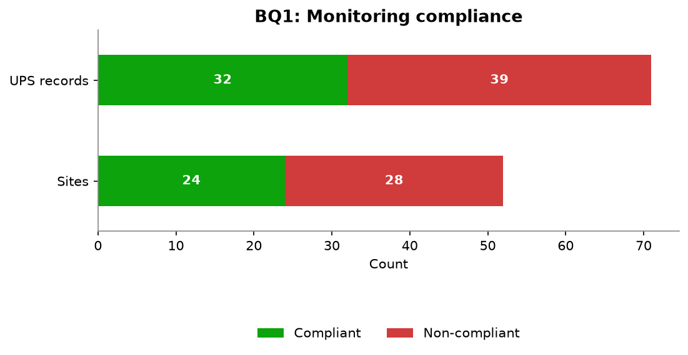
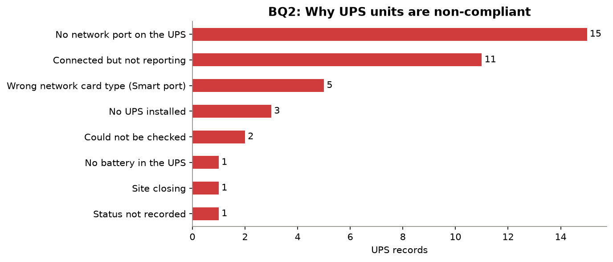
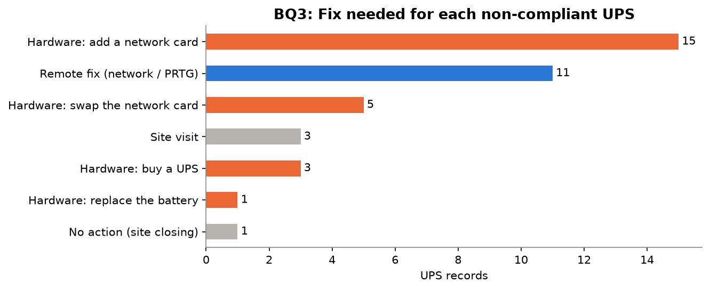
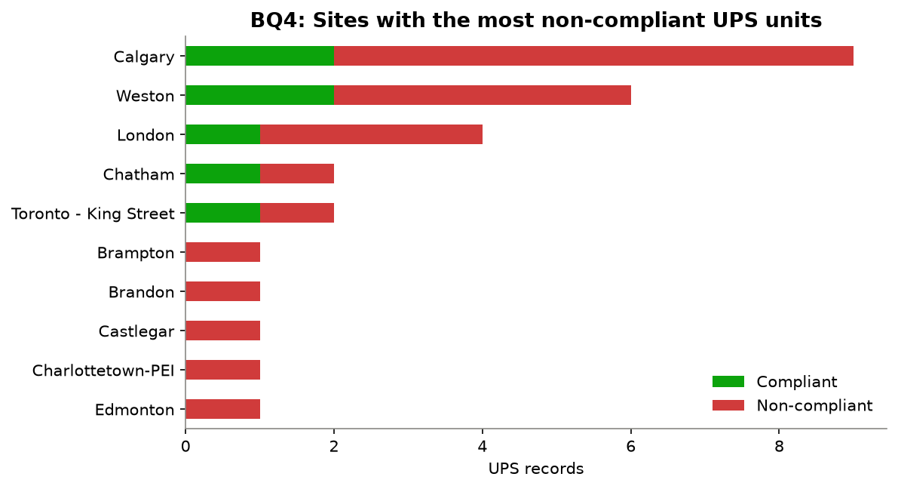
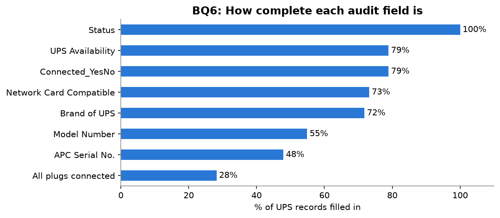

# Project 6 – UPS Monitoring Non-Compliance Audit

A Python audit of the UPS (battery backup) units protecting network racks at 52 sites. It measures how many are monitored, explains why the rest are non-compliant, and sizes the fix.

**71** UPS units audited · **52** sites · **45.1%** units monitored · **39** non-compliant units

> **Privacy:** this is a public copy of real operational data. People's names (site contacts and technicians mentioned in the notes), internal IP addresses and UPS serial numbers are replaced with placeholders (`Person A`, `10.x.x.x`, fake serials). Sites, statuses, brands and model numbers are real. See [`docs/data_cleaning_notes.md`](docs/data_cleaning_notes.md).

## Repo structure
```
Project6_NonCompliance/
├── README.md
├── requirements.txt
├── .gitignore
├── data/
│   ├── raw/
│   │   └── apc_ups_sites.csv
│   └── processed/
│       └── ups_sites_clean.csv
├── notebooks/
│   └── Project6_NonCompliance_Analysis_final.ipynb
├── images/                       # 5 charts saved by the notebook
├── presentation/
│   └── Project6_NonCompliance_Presentation_final.pptx
└── docs/
    └── data_cleaning_notes.md
```

| Data file | What it is |
|---|---|
| `data/raw/apc_ups_sites.csv` | the site-by-site UPS audit: 72 rows (71 UPS units + a total row), 18 columns |
| `data/processed/ups_sites_clean.csv` | 71 UPS units with standardised status, a compliance flag, reason and fix (written by the notebook) |

## 1. What the data is
The standard: every UPS should be **connected to the network and reporting to the monitoring tool (PRTG)**. A unit is **compliant** only if its status is **Online**.

| Column | What it holds |
|---|---|
| Item | Audit item number |
| Status | Online, Offline, No Netwk Port, Smart NtwkPort, No UPS, Could not check, ... |
| Site, City | Site name and its 3-letter site code |
| APC Connected (two columns) | Connected Yes/No, and the number of units connected |
| UPS Availability, Network Card Compatible | Whether a UPS exists and has a usable network card |
| Brand of UPS, Model Number, APC Serial No. | Hardware details |
| Notes, Additional Notes, USP location Server | Free-text notes from the technicians |

## 2. Business questions
1. **BQ1 Compliance rate:** What share of UPS units, and of sites, are monitored?
2. **BQ2 Reasons:** Why are units non-compliant?
3. **BQ3 Fixability:** What can be fixed remotely, and what needs hardware?
4. **BQ4 Sites:** Which sites carry the most risk?
5. **BQ5 Hardware:** Do brand or model explain the failures?
6. **BQ6 Audit quality:** Is the audit sheet itself reliable?

## 3. Validation and cleaning
* **The last row is a "total" row** (55 / 70), not a UPS. It is removed, leaving **71 UPS records at 52 sites**.
* **Two columns share the name "APC Connected"**: one has a hidden trailing space and holds Yes/No, the other holds a count. They are renamed `Connected_YesNo` and `Connected_Count`.
* **Item numbers:** 2 rows have no item number, and item `61` is used for 4 different UPS units at Weston.
* **The same status is spelt different ways** (`No Netwk Port` / `No Ntwk Port`, `Smart NtwkPort ` with a trailing space). They are standardised. 2 rows have no status.
* **Brand typo:** `APS` appears 17 times and is clearly APC (the model codes are APC's). It is corrected.
* **Values in the wrong column:** 3 Model Number cells hold an IP address, a technician's note or "unable to locate the data sheet" instead of a model code.
* **4 site codes are written in full** (`Blackfoot`, `EDMUNDSTON`, `SAULT STE MARIE`, `Yarmouth`) instead of 3 letters. They are shortened.
* **An empty column** at the end of the sheet is dropped.

The full list of steps is in [`docs/data_cleaning_notes.md`](docs/data_cleaning_notes.md).

## 4. Findings and recommendations
### BQ1 – Compliance rate


**Finding:** Only **32 of 71 UPS units (45.1%) are online and monitored**. At site level it is the same picture: **24 of 52 sites (46.2%)** have every UPS reporting. More than half the network is protected by a UPS that IT can't see.

**Recommendation:** Set a target (for example 90% of units monitored within one quarter) and report the compliance rate monthly from this cleaned table.

### BQ2 – Reasons


**Finding:** Of the 39 non-compliant units, the biggest reasons are **no network port on the UPS (15)** and **connected but not reporting (11)**. Next come the **wrong network card type, a "Smart" port (5)**, **no UPS installed (3)**, could not be checked (2), no battery (1), site closing (1) and status not recorded (1).

**Recommendation:** Work the list by reason, not by site: each reason has one fix that can be applied across many sites at once.

### BQ3 – Fixability


**Finding:** **11 units can be fixed remotely**: they are connected but not reporting, so the problem is the switch port, VLAN or PRTG set-up. **24 need hardware**: 15 network cards, 5 replacement cards for the Smart-port units, 3 new UPS units and 1 battery. 3 need a site visit, and 1 site is closing.

**Recommendation:** Do the 11 remote fixes first; it's quick, cheap, and lifts compliance from 45% to about 61%. Then raise one purchase order for 20 network cards, 3 UPS units and 1 battery.

### BQ4 – Sites


**Finding:** Risk is concentrated. **Calgary has 7 of its 9 UPS units non-compliant**, **Weston 4 of 6** and **London 3 of 4**. Together these three sites hold 14 of the 39 non-compliant units (36%). The other 25 are spread one per site.

**Recommendation:** Send one technician to Calgary, Weston and London with network cards. Those three visits fix over a third of the problem.

### BQ5 – Hardware

**Finding:** Every non-compliant unit with a recorded brand is APC except one Tripp-Lite, so brand is not the issue. **Model family is:** all 5 **SRT** and both **SUA** units have no network port, and the 5 Smart-port failures are **SMT and SMX** models. Most of the 20 units with no brand recorded are online, which suggests healthy sites were simply audited less thoroughly.

**Recommendation:** Buy the network card that matches each model family (SRT, SUA, SMT, SMX), and standardise new purchases on models with a built-in network port.

### BQ6 – Audit quality


**Finding:** The audit sheet is incomplete. **Only 28% of units have "All plugs connected" filled in**, 48% have a serial number, 55% a model number and 72% a brand. It also contradicts itself: **10 units are marked Connected = Yes but are Offline**, and 11 online units have the Connected field blank.

**Recommendation:** Turn the audit into a form with required fields (status, brand, model, serial) and drop-down lists, so every site is recorded the same way and statuses can't be spelt differently.

## 5. Summary
| # | Question | Answer |
|---|---|---|
| BQ1 | Compliance rate | **32 of 71 units (45.1%)**; 24 of 52 sites (46.2%) |
| BQ2 | Reasons | No network port **15**, connected but not reporting **11**, wrong card **5** |
| BQ3 | Fixability | **11 remote fixes**; **24 need hardware** |
| BQ4 | Sites | Calgary 7, Weston 4, London 3 = **36%** of the problem |
| BQ5 | Hardware | SRT/SUA lack a port; SMT/SMX have the wrong (Smart) card |
| BQ6 | Audit quality | Plugs field 28% complete; **10 "Yes but Offline"** contradictions |

**Main message:** less than half the UPS fleet is monitored. A quick round of 11 remote fixes, then one hardware order and three site visits, would take compliance from 45% to over 90%.

## 6. Presentation
[`presentation/Project6_NonCompliance_Presentation_final.pptx`](presentation/Project6_NonCompliance_Presentation_final.pptx) is a 15-slide deck with speaker notes. It covers what the data is, the 6 business questions, how the project was done, the validation results, the findings, the recommendations, and the limitations.

## 7. Limitations
- One audit snapshot; no dates
- 20 units have no brand or model recorded
- “Online” is taken from the sheet, not from PRTG itself

**Next steps:**
- Export the live PRTG status and repeat the check
- Fill in model and serial for every unit
- Re-audit after the remote fixes

## 8. How to reproduce
1. Install Python 3 and the packages in `requirements.txt`:
   ```bash
   pip install -r requirements.txt
   ```
2. Open `notebooks/Project6_NonCompliance_Analysis_final.ipynb` in Jupyter and choose **Run All**. The notebook reads `data/raw/`, writes `data/processed/` and re-creates every chart in `images/`.
3. Paths in the notebook are relative (`../data/...`, `../images/...`), so run it from the `notebooks/` folder.
